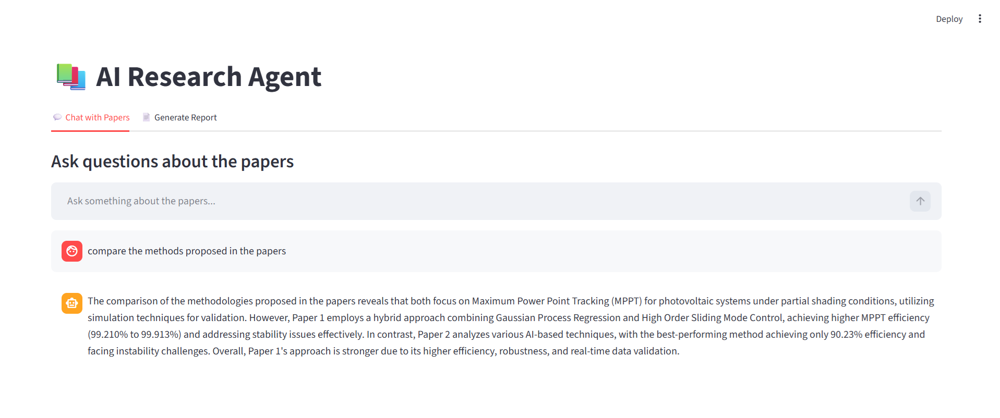
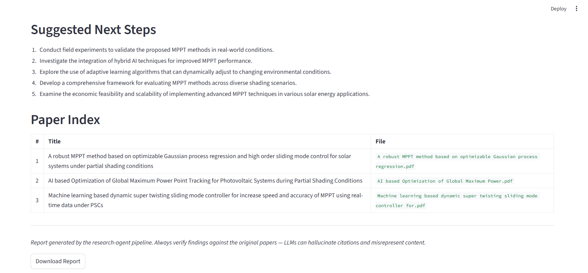
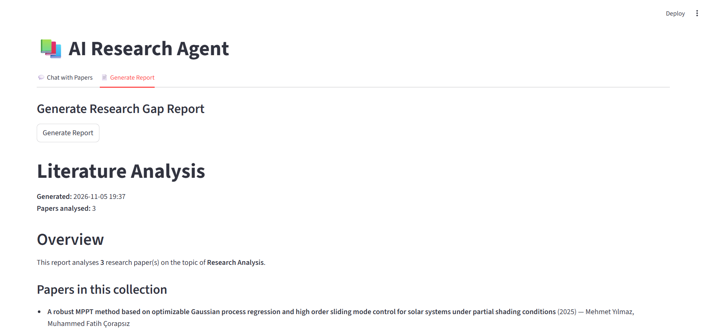

# 📚 AI Research Agent

An LLM-powered research assistant that helps analyze multiple academic papers using Retrieval-Augmented Generation (RAG), semantic search, and autonomous tool orchestration.

The system processes research papers in PDF format, extracts structured metadata, builds a searchable vector index, and enables users to explore research literature through natural-language queries. It also supports cross-paper comparison and automated research gap analysis.

## ✨ Features

- **PDF Ingestion:** Load and process multiple academic papers in PDF format.
- **Structured Metadata Extraction:** Extract paper titles, authors, publication years, abstracts, methodologies, key findings, and limitations using an LLM.
- **Semantic Search:** Retrieve relevant paper passages using Sentence Transformers embeddings and FAISS.
- **AI Research Assistant:** Ask natural-language questions about the indexed research collection.
- **Paper Summarization:** Retrieve structured summaries of individual papers.
- **Cross-Paper Comparison:** Compare research methodologies and findings across multiple papers.
- **Research Gap Analysis:** Identify common themes, contradictions, missing experiments, methodological gaps, and potential research directions.
- **Report Generation:** Generate structured Markdown reports containing paper summaries and cross-paper analysis.
- **Interactive Interface:** Use the application through a Streamlit web interface or command-line interface.

## 🏗️ Architecture

The project combines a RAG pipeline with an LLM-based ReAct agent.

### RAG Pipeline

1. **Document Loading:** Research papers are loaded from PDF files using PyPDFLoader.
2. **Metadata Extraction:** An LLM extracts structured information from the first pages of each paper.
3. **Text Chunking:** Documents are divided into overlapping chunks using RecursiveCharacterTextSplitter.
4. **Embedding Generation:** Sentence Transformers (`all-MiniLM-L6-v2`) converts text chunks into dense vector representations.
5. **Vector Indexing:** FAISS stores embeddings and associated document metadata.
6. **Semantic Retrieval:** Relevant passages are retrieved based on similarity to the user's query.

### Agent Architecture

The research assistant uses a LangChain ReAct (Reasoning and Acting) agent to select and execute tools based on the user's request.

The agent has access to three tools:

| Tool | Description |
|---|---|
| `search_papers` | Performs semantic search across indexed research papers. |
| `summarize_paper` | Retrieves structured metadata and summaries for a specific paper. |
| `compare_papers` | Compares methodologies and key findings of two research papers. |

The ReAct workflow allows the LLM to select tools, observe their outputs, and use the retrieved information to formulate an answer.

### Research Gap Analysis

The gap analysis module uses an LLM to synthesize structured metadata extracted from the paper collection.

It identifies:

- Common research themes
- Contradictions between papers
- Missing experiments
- Under-studied populations or contexts
- Methodological gaps
- Suggested future research directions

The results are formatted into a structured Markdown report.

## 🛠️ Tech Stack

| Category | Technologies |
|---|---|
| Programming Language | Python |
| LLM | OpenAI API (`gpt-4o-mini` in Streamlit) |
| LLM Orchestration | LangChain |
| RAG | Retrieval-Augmented Generation |
| Vector Database | FAISS |
| Embeddings | Sentence Transformers (`all-MiniLM-L6-v2`) |
| PDF Processing | PyPDF / PyPDFLoader |
| Data Validation | Pydantic |
| Frontend | Streamlit |
| Environment Management | Python venv, python-dotenv |

## 📂 Project Structure

```text
research-agent/
│
├── data/
│   └── papers/                 # Directory for research PDFs
│
├── src/
│   ├── tools/
│   │   ├── compare_tool.py     # Paper comparison tool
│   │   ├── search_tool.py      # Semantic search tool
│   │   └── summary_tool.py     # Paper summarization tool
│   │
│   ├── agent.py                # LangChain ReAct agent
│   ├── paper_parser.py         # PDF parsing and metadata extraction
│   ├── paper_indexer.py        # Embedding generation and FAISS indexing
│   ├── gap_analyzer.py         # Cross-paper research gap analysis
│   └── report_generator.py     # Markdown report generation
│
├── .env.example                # Environment variable template
├── .gitignore
├── app.py                      # Streamlit application
├── main.py                     # CLI entry point
└── requirements.txt            # Python dependencies
```

## ⚙️ Installation & Setup

### 1. Clone the repository

```bash
git clone https://github.com/aibat-mz/research-agent.git
cd research-agent
```

### 2. Create a virtual environment

Python 3.12 is recommended.

**Windows:**

```powershell
py -3.12 -m venv venv
.\venv\Scripts\Activate.ps1
```

**Linux / macOS:**

```bash
python3.12 -m venv venv
source venv/bin/activate
```

### 3. Install dependencies

```bash
pip install -r requirements.txt
```

### 4. Configure environment variables

Create a `.env` file based on the provided example:

```bash
cp .env.example .env
```

For Windows PowerShell:

```powershell
Copy-Item .env.example .env
```

Add your OpenAI API key:

```env
OPENAI_API_KEY=your_openai_api_key_here
```

### 5. Add research papers

Place your PDF research papers inside:

```text
data/papers/
```

PDF files are not included in the repository. Add your own research papers before launching the application.

## 🚀 Usage

### Streamlit Web Application

Launch the application:

```bash
streamlit run app.py
```

The interface provides two main sections:

**1. Chat with Papers**

Ask questions about the research collection, retrieve relevant information, summarize individual papers, and compare methodologies.

**2. Generate Report**

Generate a structured research report containing individual paper summaries, cross-paper analysis, research gaps, and suggested next steps.

### Command-Line Interface

The project also supports command-line execution.

**Start an interactive research session:**

```bash
python main.py --papers-dir data/papers --interactive
```

**Ask a single question:**

```bash
python main.py --papers-dir data/papers --query "What methodologies are used across these papers?"
```

**Generate a research gap report:**

```bash
python main.py --papers-dir data/papers --topic "Solar MPPT" --report
```

**Generate a report and specify the output path:**

```bash
python main.py --papers-dir data/papers --topic "Solar MPPT" --report --output reports/research_analysis.md
```

The CLI supports model selection through the `--model` argument or the `OPENAI_MODEL` environment variable.

## 🖥️ Screenshots

### Chat with Papers



### Research Report Generation



### Report download button



## ⚠️ Limitations

- **LLM Reliability:** Generated answers and research gap analyses may contain inaccuracies or hallucinations. Results should be verified against the original papers.
- **Metadata Extraction:** Structured metadata extraction is based on the first 3 pages and the first 3,000 characters of each PDF.
- **Retrieval Quality:** Semantic search quality depends on document extraction, chunking, and embedding relevance.
- **Paper Comparison:** The comparison tool relies on successfully matching paper titles against extracted metadata.
- **Research Gap Analysis:** The quality of identified gaps depends on the completeness and accuracy of extracted paper metadata.
- **Corpus Size:** The current implementation is designed for relatively small research collections rather than large-scale document repositories.

## 🔮 Future Improvements

Potential directions for further development include:

- More robust paper identification and title matching.
- Improved retrieval evaluation and answer-grounding mechanisms.
- Source references with page-level citations in generated answers.
- Persistent conversation history.
- More advanced research synthesis and comparison workflows.
- Evaluation using retrieval and answer-quality metrics.

## 📄 License

This project is intended for educational and portfolio purposes. Research papers used for testing are not distributed with the repository. Users should ensure they have the appropriate rights to process any documents they provide.